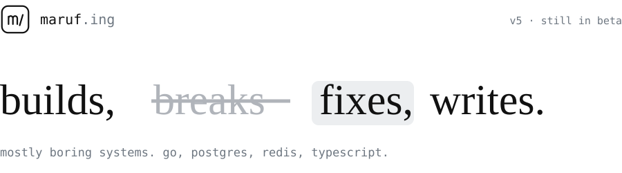

<picture>
  <source media="(prefers-color-scheme: dark)" srcset="./assets/header-dark.svg">
  <source media="(prefers-color-scheme: light)" srcset="./assets/header-light.svg">
  
</picture>

&nbsp;

<table>
  <tr><td><b>now</b></td><td>building commerce <a href="https://github.com/pathao">@pathao</a>: checkout, signup, bulk orders</td></tr>
  <tr><td><b>stack</b></td><td>Go · TypeScript · Postgres · Redis · TimescaleDB · React</td></tr>
  <tr><td><b>into</b></td><td>distributed systems, databases, the boring parts that keep things up</td></tr>
  <tr><td><b>school</b></td><td>finishing a CS degree at night, OS and networks this semester</td></tr>
  <tr><td><b>writes</b></td><td><a href="https://maruf.ing">maruf.ing</a> · <a href="https://x.com/marufing">x.com/marufing</a></td></tr>
  <tr><td><b>mail</b></td><td>hi@maruf.ing</td></tr>
</table>

### page history

- **v5 · 2025 → now** · Pathao. ~~frontend dev~~ full stack. A signup flow rebuilt as a state machine, CSV-first bulk orders, and a small Redis rate limiter that a few services share.
- **v4 · 2024 → 2025** · Fringecore. Signage running on 400+ screens, a Three.js controller for a cube-shaped LED screen, time-series dashboards on TimescaleDB.
- **v3 · 2023** · SoftValley. Two products from scratch, including a CRM for education consultants.
- **v2 · 2022** · Appstone, Bengaluru. Dashboards for healthcare and agritech teams.
- **v1 · 2021** · `git init`. MERN, and more todo apps than anyone needs.

### shipped things

- **[Figma plugin](https://www.figma.com/community/plugin/1209922740177393208)**: 30,000+ active users. TypeScript + the Figma API.
- **[city-bank-cube](https://github.com/marufing/city-bank-cube)**: Three.js control room for a cube LED screen, so operators can place content on each face.
- **[dataviztrack](https://github.com/marufing/dataviztrack)**: drop in a CSV, get tables and charts.
- **[istore](https://github.com/marufing/istore)**: open-source e-commerce storefront.

### notes to self

- create the account ~~first~~ last.
- comments explain why, not what.
- ~~rewrite it~~ reuse what already works.
- boring tech wins.

&nbsp;

last edited oct 2026 · still in beta
